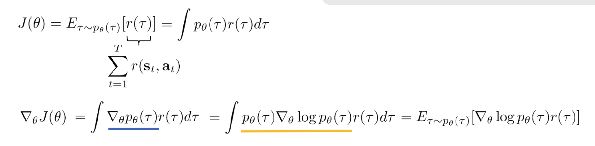

## Q: if the limits of integration involve the theta, can i still move the grad inside the integral?
Not by itself. When θ is in the limits, moving the gradient inside gives only part of the answer. The full Leibniz rule adds a term for each limit:

$$
d/dθ ∫_{a(θ)}^{b(θ)} f(x, θ) dx = f(b(θ), θ) · b′(θ) − f(a(θ), θ) · a′(θ) + ∫_{a(θ)}^{b(θ)} ∂f/∂θ dx
$$

The first two terms account for the moving limits. The last term is the "gradient moved inside" part.

**Checking it on the uniform example:** Take f = 1/θ, a = 0, b = θ.

- **Upper limit:** (1/θ) · 1 = 1/θ
- **Lower limit:** 0, since a′ = 0
- **Inside term:** ∫₀^θ (−1/θ²) dx = −1/θ
- **Total:** 1/θ − 1/θ = 0, which is correct.

**When you can just move it inside:** The boundary terms vanish if the limits don't depend on θ, or if f is zero at whichever limits do move. 

**That's why policy gradients are fine: you integrate over a fixed space of trajectories, so the limits don't involve θ.**

## Q: Leibnitz rule: Grad(integral) = Integral (Gradient)? is there any limitations to this rule or is it always true?
Example: going from $∇_θ ∫ p_θ(τ) r(τ) dτ$ to $∫ ∇_θ p_θ(τ) r(τ) dτ$. This is called differentiating under the integral sign (the Leibniz integral rule). It isn't always true, but it holds under mild conditions that the slide assumes without saying.

**When the swap is allowed:** The usual sufficient conditions, which come from the dominated convergence theorem, are these:

1. **Fixed domain:** The region you integrate over can't depend on θ. If it does, the full Leibniz rule adds extra boundary terms.
2. **Differentiable in θ:** p_θ(τ) r(τ) has to be differentiable in θ for (almost) every τ.
3. **Bounded derivative:** There has to be an integrable function g(τ) with |∇_θ p_θ(τ) r(τ)| ≤ g(τ) for all θ in a neighborhood. This stops the derivative from blowing up in the tails.

**An example where it fails:** Take p_θ(x) = Uniform(0, θ), so the density is 1/θ on [0, θ], and let r(x) = 1. Then J(θ) = 1 for every θ, so the true gradient is 0. If you swap anyway, you get ∫₀^θ ∇_θ(1/θ) dx = θ · (−1/θ²) = −1/θ, which is wrong. The swap missed the boundary term, because the support moves with θ.

**Why it's fine in this RL setting:**

- **Fixed support:** The policy is stochastic and differentiable, like a softmax or a Gaussian, so the set of possible trajectories doesn't move as θ changes. This also matters for the "convenient identity" on the slide: ∇ log p = ∇p / p needs p > 0 wherever ∇p ≠ 0.
- **Only the policy depends on θ:** The dynamics and initial state distribution don't depend on θ. So ∇_θ log p_θ(τ) reduces to Σ_t ∇_θ log π_θ(a_t|s_t), and you never need to differentiate the environment.
- **Bounded integrand:** With bounded rewards and a finite horizon T (or discounting), the domination condition is easy to meet.

**What this buys you:** The reward r(τ) never needs to be differentiable, because only p_θ gets differentiated. That's why the method works with non-differentiable rewards and black-box environments.

**When it can break in RL:**

- **Deterministic policies:** If the policy picks actions deterministically, p_θ(τ) is a point mass. The likelihood-ratio form doesn't apply, which is why deterministic policy gradient methods use a different derivation.
- **Collapsed or moving support:** It can also break if the policy's support depends on θ (like the uniform example) or a probability collapses to zero.
- **Unbounded returns:** Undiscounted infinite horizons or heavy-tailed rewards can violate the domination condition.

## Q: for the Leibniz integral rule, does the gradient variable (in this case theta) and the integral variable (in this case tau) can be the same or different?
They have to be different. The rule is about a parameter (θ) that you differentiate with respect to, and a separate integration variable (τ) that gets integrated away:

d/dθ ∫ f(τ, θ) dτ

τ is a dummy variable. After integrating, it's gone, and the result is a function of θ alone. Differentiating "with respect to τ" afterwards makes no sense, because there's no τ left.

**Where it can look like they're the same:** θ can appear in the limits, as in $d/dθ ∫₀^θ f(τ) dτ = f(θ)$. That's the fundamental theorem of calculus, a special case of Leibniz. But τ and θ are still separate variables. θ just sets where the integral stops. If you write ∫₀^x f(x) dx, that's sloppy notation, and you should rename the inner variable to avoid confusion.

On the slide, τ is the trajectory being integrated over and θ is the policy parameter, so they're clearly separate.

## Q: Show steps on why the exact per-timestep objective takes the expectation over states visited by the new policy, $d^{π_θ′}(s)$, and that does depend on θ′. This is a case when the gradient cannot move inside the expectation

**Step 0: Start from the slide**

$J(θ) = E_{τ \sim p_θ(τ)}[ Σ_{t=1}^{T} r(s_t, a_t) ]$

where $p_θ(τ) = p(s_1) · Π_t π_θ(a_t|s_t) · p(s_{t+1}|s_t, a_t)$.

**Step 1: Pull the sum out (linearity of expectation)**

$J(θ) = Σ_t E_{τ \sim p_θ(τ)}[ r(s_t, a_t) ]$

**Step 2: Each term only cares about $(s_t, a_t)$**

$r(s_t, a_t)$ doesn't depend on anything else in the trajectory, so you can integrate out every other variable:

- **Steps after t:** The future variables integrate to 1, since each is a probability distribution.
- **Steps before t:** Integrating out the earlier states and actions leaves the marginal probability of landing in $s_t$ at step t. Call it $p_θ(s_t)$.

That gives

$E_τ[ r(s_t, a_t) ] = E_{s_t \sim p_θ(s_t)} E_{a_t \sim π_θ(a_t|s_t)}[ r(s_t, a_t) ]$

so

$J(θ) = Σ_t E_{s_t \sim p_θ(s_t)} E_{a_t ~ π_θ(a_t|s_t)}[ r(s_t, a_t) ]$

**Step 3: Notice θ shows up twice**

- **In $π_θ(a_t|s_t)$:** This is the direct effect, which action you pick.
- **In $p_θ(s_t)$:** This is the indirect effect. It depends on all the earlier actions, which came from $π_θ$.

The $d^θ(s)$ I wrote before is just shorthand for these per-step state marginals $p_θ(s_t)$, averaged over t. Nothing new is added.

**Step 4: Connect to slide 24**

The slide's double sum $(1/N) Σ_i Σ_t$ is the sample estimate of $Σ_t E_{(s_t, a_t) \sim p_θ}$. Its importance weight is

$π_θ′(s_t, a_t) / π_θ(s_t, a_t) = [ p_θ′(s_t) / p_θ(s_t) ] · [ π_θ′(a_t|s_t) / π_θ(a_t|s_t) ]$

- **The second ratio** is the action part that survives in the "common final form."
- **The first ratio** is the state part from Step 3, the one the slide calls hard to measure and sets to 1.

Setting it to 1 is what drops the indirect effect: the new policy's effect on which states you visit. 

**Here's a clean derivation using the resutls above:**

The true objective depends on θ′ in two places, and the per-timestep version only accounts for one of them.

**The true objective:**

$J(θ′) = E_{s \sim d^{θ′}} E_{a \sim π_θ′}[ return from (s, a) ]$

θ′ affects the actions you pick in a given state, through $π_θ′(a|s)$. It also affects which states you reach, through $d^{θ′}(s)$, because earlier actions steer you into different parts of the environment.

**What importance sampling fixes:** Your data comes from the old policy θ. Reweighting by $π_θ′(a|s)/π_θ(a|s)$ corrects for the action choice. That ratio is easy to compute, since you know both policies.

**What it can't fix:** Your sampled states came from $d^θ$, not $d^{θ′}$. Correcting that would need the ratio $d^{θ′}(s)/d^θ(s)$, and that's hard for two reasons:

- **It needs the dynamics:** The state distribution depends on the environment's dynamics, which you usually don't know.
- **It brings back the product:** Writing it out gives the product of all earlier action ratios, which is the exploding or vanishing term the per-timestep form was meant to avoid.

So the slide sets that ratio to 1, which means pretending the new policy visits the same states as the old one.

**What you end up optimizing:** A surrogate objective:

$L(θ′) = E_{s \sim d^θ, a \sim π_θ}[ (π_θ′(a|s) / π_θ(a|s)) · return ]$

Here the sampling distribution is fixed, so moving the gradient inside is perfectly legal. The issue isn't the swap. It's that L(θ′) is a different function from J(θ′). L's gradient ignores how changing θ′ changes which states you'll reach.

**Example:** Say the new policy turns left at step 1 instead of right, and that leads to a completely different region. The surrogate still scores the later actions using states from the "right" branch, because that's all your data contains. It can't see the consequences of steering somewhere new.

**Why it still works:**

- **Exact at θ′ = θ:** The state ratio is exactly 1, and ∇L(θ′) equals the true policy gradient ∇J. The policy gradient theorem shows the derivative of the state distribution doesn't appear in the gradient there.
- **Small gap nearby:** As θ′ moves away from θ, the gap between L and J grows, roughly in proportion to how different the two policies are (for example, their KL divergence).

So L is a good local stand-in for J. Trust-region methods are built on this: TRPO constrains the KL divergence and PPO clips the ratio, so each update stays in the region where the surrogate is accurate.
