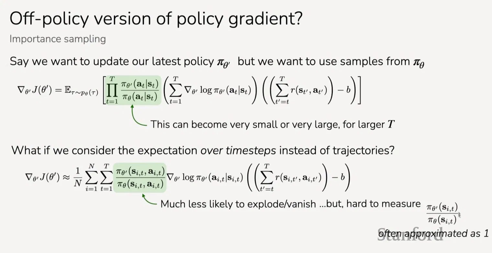

## Q: importance sampling. explain this
This slide is walking through how to turn the (on-policy) policy gradient into an **off-policy** one using importance sampling, and why the naïve version breaks down. Let me build it up.

## The core trick: importance sampling

Importance sampling estimates an expectation under one distribution $p$ using samples drawn from a *different* distribution $q$:

$$\mathbb{E}_{x\sim p}[f(x)] = \mathbb{E}_{x\sim q}\left[\frac{p(x)}{q(x)}f(x)\right]$$

You draw from the "wrong" distribution $q$, then reweight each sample by the ratio $p(x)/q(x)$ to correct for the mismatch. That ratio is the *importance weight*.

## Why we want this here

Policy gradient is on-policy: to estimate $\nabla J(\theta')$ you need trajectories sampled from $\pi_{\theta'}$ itself. Every time you update the parameters, your old data becomes stale. That's wasteful. The goal here is to update the new policy $\pi_{\theta'}$ while reusing samples collected under the old policy $\pi_\theta$.

## Applying it to whole trajectories (first equation)

The objective is $J(\theta') = \mathbb{E}_{\tau\sim p_{\theta'}(\tau)}[r(\tau)]$, but we only have trajectories from $p_\theta(\tau)$. So we importance-sample with weight $p_{\theta'}(\tau)/p_\theta(\tau)$.

The probability of a trajectory factors as $p_\theta(\tau) = p(s_1)\prod_t \pi_\theta(a_t|s_t)\, p(s_{t+1}|s_t,a_t)$. The initial-state distribution and the dynamics $p(s_{t+1}|s_t,a_t)$ **don't depend on the policy parameters**, so they cancel in the ratio, leaving just the product of action-probability ratios:

$$\frac{p_{\theta'}(\tau)}{p_\theta(\tau)} = \prod_{t=1}^{T}\frac{\pi_{\theta'}(a_t|s_t)}{\pi_\theta(a_t|s_t)}$$

That's the green-highlighted term in the top equation.

## The problem (first arrow)

This weight is a **product of $T$ terms**. Even if each individual ratio is close to 1, multiplying many of them compounds:

- If the ratios sit slightly below 1, the product decays exponentially toward 0 → **vanishes**.
- If slightly above 1, it grows exponentially → **explodes**.

So for any long horizon $T$, the importance weight has enormous variance and the estimate becomes useless. This is the classic failure mode of importance sampling over trajectories.

## The fix attempt (second equation): expectation over timesteps

Instead of treating a whole trajectory as one sample, treat each individual $(s_{i,t}, a_{i,t})$ as a sample. Now the importance weight only needs to correct for the *marginal* state–action distribution at a single timestep, rather than a product over the whole trajectory:

$$\frac{\pi_{\theta'}(s_{i,t}, a_{i,t})}{\pi_\theta(s_{i,t}, a_{i,t})}$$

This is a **single ratio per timestep** — no product over $T$, so no exponential compounding. Much less likely to blow up or die.

## The catch (second arrow) and the "≈ 1" note

That per-timestep joint ratio factors into two pieces:

$$\underbrace{\frac{p_{\theta'}(s_{i,t})}{p_\theta(s_{i,t})}}_{\text{state marginal ratio}} \cdot \underbrace{\frac{\pi_{\theta'}(a_{i,t}|s_{i,t})}{\pi_\theta(a_{i,t}|s_{i,t})}}_{\text{action ratio}}$$

The action ratio is easy — you can evaluate both policies on the sampled action. But the **state-marginal ratio** is the hard part: it asks "how much more likely is the new policy to *visit* this state?", which requires the full state-visitation distribution under each policy. That depends on rolling the policy through the dynamics and is generally intractable to compute. That's the "hard to measure" the bottom-right note refers to.

The practical move — the "**often approximated as 1**" — is to simply drop that state-marginal ratio, assuming the two policies visit states similarly. This is reasonable *when the policies are close*. What's left is just the action ratio:

$$\frac{\pi_{\theta'}(a_t|s_t)}{\pi_\theta(a_t|s_t)}$$

This is exactly the surrogate objective at the heart of **TRPO and PPO**, where you keep this single per-timestep ratio and then constrain or clip it so the two policies can't drift too far apart (which is what keeps the approximation valid and the variance controlled).

(The $b$ throughout is just the usual variance-reduction baseline subtracted from the return; it doesn't interact with the importance-sampling story.)

So the arc of the slide is: trajectory-level IS is exact but explodes/vanishes → per-timestep IS is stable but needs an intractable state-distribution ratio → approximate that ratio as 1 → land on the PPO/TRPO-style objective.

## Q: but not all terms in the product are going to be above 1 or below 1 all at once, some above and some below, no? so why do you conclude vanishing or exploding ratio?
You're right to push on this, and my earlier phrasing was sloppy. In a real trajectory the ratios *are* mixed — some above 1, some below — so "they all drift one way" is wrong. The actual reason is subtler, and it's worth getting right.

The key move is to take logs. The product becomes a **sum**:

$$\log \prod_{t=1}^{T}\frac{\pi_{\theta'}(a_t|s_t)}{\pi_\theta(a_t|s_t)} = \sum_{t=1}^{T}\log\frac{\pi_{\theta'}(a_t|s_t)}{\pi_\theta(a_t|s_t)}$$

So now it's a random walk of $T$ steps, and your intuition ("positives and negatives cancel") is really a claim that this sum stays near 0. Two facts about that sum break the cancellation.

**The sum has negative drift.** The actions are sampled from the *old* policy $\pi_\theta$. The expected value of one log-ratio term under that sampling is

$$\mathbb{E}_{a\sim\pi_\theta}\left[\log\frac{\pi_{\theta'}(a|s)}{\pi_\theta(a|s)}\right] = -D_{\mathrm{KL}}\big(\pi_\theta \,\|\, \pi_{\theta'}\big) \le 0.$$

It's a KL divergence, so it's negative whenever the two policies differ at all. Each step of the walk has negative expected drift, so the sum trends toward $-T \cdot \overline{D}_{\mathrm{KL}}$, i.e. linearly downward in $T$. Exponentiating, the *typical* (median/geometric-mean) weight shrinks toward zero. That's the vanishing — and it happens even though individual terms are mixed, because the down-steps are, on average, slightly more common or slightly larger. This is just the statement that the geometric mean sits below the arithmetic mean.

**But the mean weight is exactly 1.** You can check directly:

$$\mathbb{E}_{a\sim\pi_\theta}\left[\frac{\pi_{\theta'}(a|s)}{\pi_\theta(a|s)}\right] = \sum_a \pi_\theta(a|s)\,\frac{\pi_{\theta'}(a|s)}{\pi_\theta(a|s)} = \sum_a \pi_{\theta'}(a|s) = 1.$$

So the average never moves. If the typical value collapses to ~0 but the average stays pinned at 1, the only way to reconcile that is a **thin tail of enormous weights**: a tiny fraction of trajectories carry astronomically large importance weights that single-handedly hold the mean up. That's the exploding — not most trajectories, just rare ones, but they dominate any finite-sample estimate.

Quantitatively, the variance of the sum of log-ratios grows like $T$, so the log-weight's spread grows like $\sqrt{T}$, and after exponentiating the variance of the weight itself grows roughly like $(1+\sigma^2)^T$ — exponential in the horizon.

So "vanish or explode" isn't the whole product going uniformly one direction. It's both at once: the **typical** trajectory's weight vanishes, while the **variance** explodes because a handful of rare trajectories get gigantic weights.

Why doesn't the mixing save you? Because multiplicative noise doesn't self-cancel the way additive noise does. Take a symmetric toy case: each ratio is $2$ or $\tfrac12$ with equal probability — perfectly "balanced," geometric mean exactly 1. The product after $T$ steps is $2^{(U-D)}$, where $U-D$ is a mean-zero random walk that wanders by $\pm\sqrt{T}$. So the weight is $2^{\pm\sqrt{T}}$ — sometimes vast, sometimes minuscule — and its arithmetic mean is $1.25^T$, which blows up. Even with textbook-balanced up/down terms, the distribution spreads out catastrophically. The cancellation you'd need requires the log-sum to stay pinned near 0, and both the drift and the $\sqrt T$ fluctuations prevent that.

That's exactly why the per-timestep formulation on the slide helps: replacing the length-$T$ product with a single ratio removes the multiplicative compounding entirely, so there's no random walk to run away.

## Q: can you just randomly switch from trajectory sampling to time step sampling. or is there some assumption here that the ratios corresponding to all other time steps in the trajectory are assumed ~1?
Great question — and the honest answer is that no, you can't *just* switch; but the switch that's being made is legitimate, and your "other timesteps ≈ 1" intuition turns out to be *exactly* the right way to see what's really being assumed. Let me connect the two.

## Q: The switch isn't arbitrary — it comes from a different (but exact) way of writing $J$

The first equation writes the objective as an expectation over **whole trajectories**. The second one comes from writing the *same* objective as an expectation over **state–action marginals**, one timestep at a time:

$$J(\theta') = \sum_{t} \mathbb{E}_{(s_t,a_t)\sim p_{\theta'}(s_t,a_t)}\big[r(s_t,a_t)\big]$$

Now importance-sample that marginal using samples from $p_\theta$:

$$= \sum_{t}\mathbb{E}_{(s_t,a_t)\sim p_\theta(s_t,a_t)}\left[\frac{p_{\theta'}(s_t,a_t)}{p_\theta(s_t,a_t)}\,r(s_t,a_t)\right]$$

This is still **exact**. Nothing has been dropped yet. The single marginal weight $\frac{p_{\theta'}(s_t,a_t)}{p_\theta(s_t,a_t)}$ factors cleanly into a state part and an action part:

$$\frac{p_{\theta'}(s_t,a_t)}{p_\theta(s_t,a_t)} = \underbrace{\frac{p_{\theta'}(s_t)}{p_\theta(s_t)}}_{\text{state visitation}}\cdot\underbrace{\frac{\pi_{\theta'}(a_t|s_t)}{\pi_\theta(a_t|s_t)}}_{\text{action}}$$

## Q: The exact marginal weight and the trajectory product are the same quantity

Here's the part that answers you directly. Where did the length-$T$ product go? It didn't vanish — it's *hiding inside the state ratio*.

Recall that the probability of reaching state $s_t$ differs between the two policies only through the action choices that led there (the dynamics $p(s_{t'+1}|s_{t'},a_{t'})$ cancel, as before). So for a sampled trajectory, the product of ratios over the **leading-up** timesteps

$$\prod_{t'=1}^{t-1}\frac{\pi_{\theta'}(a_{t'}|s_{t'})}{\pi_\theta(a_{t'}|s_{t'})}$$

*is* the sample-level realization of the state-visitation ratio $\frac{p_{\theta'}(s_t)}{p_\theta(s_t)}$. In other words:

$$\underbrace{\prod_{t'=1}^{t}\frac{\pi_{\theta'}(a_{t'}|s_{t'})}{\pi_\theta(a_{t'}|s_{t'})}}_{\text{trajectory product up to }t} \;\longleftrightarrow\; \underbrace{\frac{p_{\theta'}(s_t)}{p_\theta(s_t)}}_{\text{all the past ratios}}\cdot\underbrace{\frac{\pi_{\theta'}(a_t|s_t)}{\pi_\theta(a_t|s_t)}}_{\text{the ratio at }t}$$

So switching to the marginal form loses *nothing*. The trajectory product and "state-ratio × action-ratio" are literally the same thing written two ways. That's why it's a legitimate re-derivation, not sleight of hand.

## Q: Where the assumption actually enters — and it's exactly what you guessed

The approximation is the **last** step: setting the state-visitation ratio to 1,

$$\frac{p_{\theta'}(s_t)}{p_\theta(s_t)} \approx 1,$$

which leaves only the single action ratio $\frac{\pi_{\theta'}(a_t|s_t)}{\pi_\theta(a_t|s_t)}$ — the "often approximated as 1" note on the slide.

And given the equivalence above, dropping that state ratio is **precisely** setting the product of all the *other* (leading-up) timesteps' ratios equal to 1. So your instinct is dead on. It's not that each individual other-timestep ratio is assumed to be 1 — it's that their **cumulative product** is assumed to be ≈ 1, i.e. the two policies wander into the same states with nearly the same frequency.

(Strictly, the fully-correct estimator also carries importance weights on the future actions inside the reward-to-go term; those get dropped in the same spirit. Same phenomenon, future side instead of past side.)

## When is that legitimate?

Exactly when $\pi_{\theta'} \approx \pi_\theta$. If the new and old policies are close, the state-visitation distributions they induce are close, so their ratio really is near 1 and throwing it away costs little. If the policies drift far apart, the assumption is bad — the product of those "other" ratios is precisely the runaway quantity from the previous discussion.

This is the whole reason TRPO and PPO exist: they keep only the single per-timestep action ratio (having discarded the state ratio), and then *enforce* $\pi_{\theta'} \approx \pi_\theta$ — via a KL trust region (TRPO) or ratio clipping (PPO) — so that the "product of the other timesteps ≈ 1" assumption you spotted is actually kept true, rather than just hoped for.

## Q: you mean the future step ratios will come in when we calculate the cum future reward term?
Yes — exactly. Let me make the structure explicit, because it splits the importance weights into three neat groups and your question is about the third.

Start from the causal (reward-to-go) policy gradient and importance-sample it. The fully-correct off-policy estimator, after applying causality, is:

$$\nabla_{\theta'} J(\theta') = \mathbb{E}_{\tau\sim\pi_\theta}\left[\sum_{t=1}^{T}\nabla_{\theta'}\log\pi_{\theta'}(a_t|s_t)\sum_{t'=t}^{T}\left(\prod_{t''=1}^{t'}\frac{\pi_{\theta'}(a_{t''}|s_{t''})}{\pi_\theta(a_{t''}|s_{t''})}\right)r(s_{t'},a_{t'})\right]$$

Look at the weight attached to a single future reward $r(s_{t'}, a_{t'})$ with $t' \ge t$. It's a product of ratios running from step $1$ all the way up to $t'$. Split that product at the current step $t$:

$$\prod_{t''=1}^{t'}\frac{\pi_{\theta'}}{\pi_\theta} = \underbrace{\prod_{t''=1}^{t}\frac{\pi_{\theta'}}{\pi_\theta}}_{\text{past + present}}\cdot\underbrace{\prod_{t''=t+1}^{t'}\frac{\pi_{\theta'}}{\pi_\theta}}_{\text{future}}$$

So the three groups are:

- **Past ratios** ($1$ to $t-1$): correct for *how you arrived* at $s_t$. This is the sample-level realization of the state-visitation ratio $p_{\theta'}(s_t)/p_\theta(s_t)$ — the thing from the last message.
- **Present ratio** (at $t$): the single action ratio $\pi_{\theta'}(a_t|s_t)/\pi_\theta(a_t|s_t)$ — the one PPO/TRPO keep.
- **Future ratios** ($t+1$ to $t'$): these are the ones you're asking about. They ride *inside the reward-to-go term*, one growing product per future reward, because each reward $r(s_{t'},a_{t'})$ was collected along a path whose actions were drawn from $\pi_\theta$. To evaluate that reward-to-go's expectation under $\pi_{\theta'}$, you have to reweight the future actions that led to it.

So your reading is right: the future step ratios enter precisely through the cumulative future reward. Each term $r(s_{t'},a_{t'})$ in the reward-to-go carries its own product of action ratios from $t{+}1$ up to $t'$.

One useful detail on why the product for a reward at $t'$ stops *at* $t'$ and not at $T$: actions taken *after* a reward can't causally affect it, so their ratios are independent of that reward and each has expectation exactly 1 under $\pi_\theta$ (that's the $\sum_a \pi_{\theta'}(a|s) = 1$ identity from before). That's what lets us truncate the product at $t'$ — otherwise every reward would carry the full length-$T$ product.

And the punchline connecting to the slide: the practical estimator drops the past product (state ratio ≈ 1) **and** the future products (reward-to-go ratios ≈ 1), keeping only the present action ratio. Both approximations are the same bet — that $\pi_{\theta'}\approx\pi_\theta$, so any product of "other-timestep" ratios, whether reaching backward to $s_t$ or forward through the reward-to-go, stays near 1. TRPO/PPO then enforce that closeness rather than just assuming it.

## Q: wait, you just proved in that prior discussion that we cannot make this assumption and now you are contradicting yourself?
Not a contradiction — but I see exactly why it reads like one, and it's a fair hit. Let me pin down what the two claims actually are, because they're about *different regimes*.

The earlier "runaway" argument and the later "≈ 1" approximation both talk about the same object — a product of importance ratios over timesteps — but under two different conditions:

**Earlier claim:** *If the two policies are arbitrarily far apart, the length-$T$ product explodes/vanishes.* This is why naïve off-policy policy gradient over full trajectories fails. The product runs away because nothing constrains $\pi_{\theta'}$ from being wildly different from $\pi_\theta$.

**Later claim:** *If the two policies are close, the product of the "other" ratios is ≈ 1, so we can drop it.* This is what PPO/TRPO exploit.

These aren't in tension — they're the two ends of the same knob. The product's behavior depends entirely on how far $\pi_{\theta'}$ has drifted from $\pi_\theta$:

- Policies far apart → each ratio deviates a lot from 1 → the product compounds into the runaway. **Assumption invalid.**
- Policies close → each ratio sits near 1 → their product stays near 1. **Assumption valid.**

So dropping the state/future ratios is **not** an unconditional move. It is *only* licensed when $\pi_{\theta'}\approx\pi_\theta$. The earlier discussion showed what happens when that condition is violated; the later discussion assumes the condition holds. Both are true statements about the same product, conditioned on the closeness of the policies.

Here's the part that I think resolves the apparent contradiction fully: **the approximation would be illegitimate on its own** — you're right that you can't just wave the runaway product away by fiat. What makes it legitimate is that TRPO and PPO don't merely *hope* the policies stay close; they **enforce** it. TRPO adds a hard KL trust-region constraint, $D_{\mathrm{KL}}(\pi_\theta\|\pi_{\theta'}) \le \delta$; PPO clips the action ratio so gradients vanish once it strays outside $[1-\epsilon, 1+\epsilon]$. Both are machinery whose entire job is to keep $\pi_{\theta'}\approx\pi_\theta$ within each update — which is precisely the condition that turns the runaway product into a ≈ 1 product you're allowed to drop.

So the logical structure is:

1. The product runs away *in general* (earlier). ✔
2. Therefore you may **not** drop it *in general*. ✔ (your objection, and it's correct)
3. So we *force* the policies to stay close, making the product ≈ 1 *by construction*. ✔
4. *Now* — and only now — dropping it is justified. ✔

The approximation isn't a claim that the runaway problem doesn't exist; it's a claim that we've **spent effort to stay in the regime where the runaway hasn't kicked in yet**. Without the trust region or clipping, your objection stands and the approximation is unjustified. That's not a footnote — it's the whole reason those two algorithms are built the way they are.

## Q: show me step by step how she gets from the top equation to the bottom equation.
Here's the path. Two things to know up front: the slide's notation $\pi_\theta(s_{i,t},a_{i,t})$ means the joint marginal $p_\theta(s_t,a_t)$, i.e. the probability of being in state $s_t$ **and** taking $a_t$ at time $t$. And the "$\approx$" in the bottom equation hides one real approximation, which I'll point out when we hit it.

## Step 0: Don't start from the top equation, start from the on-policy gradient

The top equation is importance sampling applied to whole trajectories. The bottom equation applies importance sampling to something else. So both branch off from the same on-policy gradient:

$$\nabla_{\theta'}J(\theta') = \mathbb{E}_{\tau\sim p_{\theta'}(\tau)}\left[\sum_{t=1}^{T}\nabla_{\theta'}\log\pi_{\theta'}(a_t|s_t)\left(\sum_{t'=t}^{T}r(s_{t'},a_{t'}) - b\right)\right]$$

- **Top equation:** importance sample $p_{\theta'}(\tau)$ with $p_\theta(\tau)$. The ratio is the product over all $T$ steps.
- **Bottom equation:** first rewrite this expression per timestep, then importance sample that. Steps 1 to 4 below.

## Step 1: Pull the sum over $t$ outside

Linearity of expectation:

$$\nabla_{\theta'}J(\theta') = \sum_{t=1}^{T}\mathbb{E}_{\tau\sim p_{\theta'}(\tau)}\left[\nabla_{\theta'}\log\pi_{\theta'}(a_t|s_t)\left(\hat{R}_t - b\right)\right], \qquad \hat{R}_t = \sum_{t'=t}^{T}r(s_{t'},a_{t'})$$

Exact.

## Step 2: Turn each term into an expectation over $(s_t,a_t)$

Inside term $t$, the $\nabla\log\pi$ factor depends only on $(s_t,a_t)$. So condition on $(s_t,a_t)$ and average everything else away:

$$\nabla_{\theta'}J(\theta') = \sum_{t=1}^{T}\mathbb{E}_{(s_t,a_t)\sim p_{\theta'}(s_t,a_t)}\Big[\nabla_{\theta'}\log\pi_{\theta'}(a_t|s_t)\,\big(\mathbb{E}_{\theta'}[\hat{R}_t\mid s_t,a_t] - b\big)\Big]$$

Exact. The past disappears into the marginal $p_{\theta'}(s_t,a_t)$, and the future rewards are averaged inside $\mathbb{E}_{\theta'}[\hat R_t\mid s_t,a_t]$.

## Step 3: Importance sample the outer expectation

We want samples of $(s_t,a_t)$ from the old policy. Standard importance sampling, $\mathbb{E}_{p}[f] = \mathbb{E}_{q}\left[\frac{p}{q}f\right]$:

$$\nabla_{\theta'}J(\theta') = \sum_{t=1}^{T}\mathbb{E}_{(s_t,a_t)\sim p_{\theta}(s_t,a_t)}\left[\frac{p_{\theta'}(s_t,a_t)}{p_{\theta}(s_t,a_t)}\nabla_{\theta'}\log\pi_{\theta'}(a_t|s_t)\,\big(\mathbb{E}_{\theta'}[\hat{R}_t\mid s_t,a_t] - b\big)\right]$$

Exact. This is where the single green ratio on the bottom line comes from.

## Step 4: Use the old policy's reward-to-go (the approximation)

$\mathbb{E}_{\theta'}[\hat R_t\mid s_t,a_t]$ is the expected future return if the **new** policy acts from $t+1$ onward. But our data only has rewards from the **old** policy acting. So we substitute what we can measure:

$$\mathbb{E}_{\theta'}[\hat{R}_t\mid s_t,a_t] \;\approx\; \mathbb{E}_{\theta}[\hat{R}_t\mid s_t,a_t]$$

This is the approximation. It's fine when $\pi_{\theta'}$ is close to $\pi_\theta$, since then both policies get similar future returns.

## Step 5: Replace expectations with sample averages

Collect $N$ trajectories from $\pi_\theta$. Each trajectory $i$ visits $(s_{i,t},a_{i,t})$ at every timestep $t$, which gives one sample from $p_\theta(s_t,a_t)$ for each $t$, along with the observed reward-to-go $\sum_{t'=t}^T r(s_{i,t'},a_{i,t'})$ as a single sample of $\mathbb{E}_\theta[\hat R_t\mid s_t,a_t]$. Averaging over $i$:

$$\nabla_{\theta'}J(\theta') \approx \frac{1}{N}\sum_{i=1}^{N}\sum_{t=1}^{T}\frac{p_{\theta'}(s_{i,t},a_{i,t})}{p_{\theta}(s_{i,t},a_{i,t})}\nabla_{\theta'}\log\pi_{\theta'}(a_{i,t}|s_{i,t})\left(\left(\sum_{t'=t}^{T}r(s_{i,t'},a_{i,t'})\right) - b\right)$$

That's the bottom equation (with $p$ written as $\pi$ on the slide).

## Step 6: The "often approximated as 1" note

The green ratio splits as

$$\frac{p_{\theta'}(s_t,a_t)}{p_{\theta}(s_t,a_t)} = \frac{p_{\theta'}(s_t)}{p_{\theta}(s_t)}\cdot\frac{\pi_{\theta'}(a_t|s_t)}{\pi_{\theta}(a_t|s_t)}$$

The second factor is easy to compute. The first one, the state ratio, is not, so it gets set to 1. Left over is just $\frac{\pi_{\theta'}(a_t|s_t)}{\pi_\theta(a_t|s_t)}$, which is the PPO ratio.

## Summary

| Step | What happens | Exact? |
|---|---|---|
| 1 | Sum over $t$ moved outside | Yes |
| 2 | Each term written as expectation over $(s_t,a_t)$ | Yes |
| 3 | Importance sample $(s_t,a_t)$ | Yes |
| 4 | New policy's future return ≈ old policy's | **No** |
| 5 | Expectations → sample averages | Monte Carlo |
| 6 | State ratio ≈ 1 | **No** |

So the top and bottom equations are siblings, not one derived from the other: both start from the same gradient, the top importance samples whole trajectories, the bottom importance samples one timestep at a time.

## Q: i don't follow. doesn't Rt depend on st, at? also, what does it mean to say average everything else out? why can we do this?
Yes, $\hat R_t$ does depend on $(s_t,a_t)$. It also depends on everything **after** $t$. That difference is the whole point of Step 2, so let me redo it slowly.

## What each factor depends on

Split the trajectory into three chunks:

- **past**: $s_1,a_1,\ldots,s_{t-1},a_{t-1}$
- **now**: $(s_t,a_t)$
- **future**: $s_{t+1},a_{t+1},\ldots,s_T,a_T$

Then inside term $t$:

| Factor | Depends on |
|---|---|
| $\nabla\log\pi_{\theta'}(a_t\|s_t)$ | now only |
| $\hat R_t = r(s_t,a_t) + r(s_{t+1},a_{t+1}) + \ldots$ | now **and** future |
| neither | past |

So $\nabla\log\pi$ and $\hat R_t$ are treated differently because $\nabla\log\pi$ depends on now only, while $\hat R_t$ also needs the future.

## Write the expectation as a sum and regroup

Use discrete sums so it's concrete. Call $f(\text{now}) = \nabla\log\pi_{\theta'}(a_t|s_t)$ and $g(\text{now},\text{future}) = \hat R_t - b$. The expectation is literally

$$\mathbb{E}[f\,g] = \sum_{\text{past}}\sum_{\text{now}}\sum_{\text{future}} p(\text{past},\text{now},\text{future})\; f(\text{now})\; g(\text{now},\text{future})$$

**(a) Sum out the past.** Nothing in $f\,g$ involves the past, so summing $p$ over it just gives the marginal (same move as the earlier derivation):

$$= \sum_{\text{now}}\sum_{\text{future}} p(\text{now},\text{future})\; f(\text{now})\; g(\text{now},\text{future})$$

**(b) Factor the joint** with the product rule, $p(\text{now},\text{future}) = p(\text{now})\,p(\text{future}\mid\text{now})$:

$$= \sum_{\text{now}} p(\text{now})\sum_{\text{future}} p(\text{future}\mid\text{now})\; f(\text{now})\; g(\text{now},\text{future})$$

**(c) Pull $f$ out of the inner sum.** The inner sum runs over the future with "now" held fixed, and $f$ only depends on now, so it's a constant there:

$$= \sum_{\text{now}} p(\text{now})\; f(\text{now})\underbrace{\left[\sum_{\text{future}} p(\text{future}\mid\text{now})\; g(\text{now},\text{future})\right]}_{\mathbb{E}[g\,\mid\,\text{now}]}$$

You **cannot** do the same with $g$, since it changes as the future changes. So $g$ stays inside, and the bracket is its average over the future with $(s_t,a_t)$ held fixed.

## That's what "average everything else away" means

- The **past** is summed out because nothing depends on it (step a).
- The **future** is summed out inside the bracket, but $\hat R_t$'s dependence on $(s_t,a_t)$ survives: the bracket is a function of $(s_t,a_t)$.

Written in the original notation:

$$\mathbb{E}_{\tau\sim p_{\theta'}}\Big[\nabla\log\pi_{\theta'}(a_t|s_t)\,(\hat R_t - b)\Big] = \mathbb{E}_{(s_t,a_t)\sim p_{\theta'}(s_t,a_t)}\Big[\nabla\log\pi_{\theta'}(a_t|s_t)\,\big(\underbrace{\mathbb{E}_{\theta'}[\hat R_t\mid s_t,a_t]}_{\text{still depends on }s_t,a_t} - b\big)\Big]$$

## Why is this allowed?

Because steps (a) to (c) are just rewriting a sum: marginalizing, the product rule, and pulling a constant out of a sum. No assumption, no approximation. In probability textbooks this is called the **law of total expectation** (or tower property): $\mathbb{E}[X] = \mathbb{E}_Y\big[\mathbb{E}[X\mid Y]\big]$, with $Y = (s_t,a_t)$.

The reason it's useful: the outer expectation is now over $(s_t,a_t)$ alone, which is exactly the thing we want to importance sample one timestep at a time in Step 3.

## Q: in practice, this would involve taking the average future sum of rewards from (st, at) of every trajectory in that sample that includes the (st, at) state?
Conceptually, yes: that's exactly what $\mathbb{E}[\hat R_t\mid s_t,a_t]$ means. Fix $(s_t,a_t)$, look at all the futures that follow it, and average their reward-to-go. But in practice nobody does that grouping, for two reasons.

## 1. You almost never see the same $(s_t,a_t)$ twice

In any realistic problem (continuous states, images, robot joint angles, LLM token prefixes), each sampled $(s_{i,t},a_{i,t})$ is unique. So "every trajectory that includes this pair" is a group of size one, just the trajectory you sampled it from. There is nothing to average over.

## 2. You don't need to, because a single sample is already unbiased

This is the key point. The tower property works in both directions:

$$\mathbb{E}\big[f(s_t,a_t)\,\hat R_t\big] = \mathbb{E}_{(s_t,a_t)}\Big[f(s_t,a_t)\;\mathbb{E}[\hat R_t\mid s_t,a_t]\Big]$$

The left side says: draw a whole trajectory, compute $f \cdot \hat R_t$ on it, average over trajectories. That's exactly what the bottom equation on the slide does, with $\sum_{t'=t}^T r(s_{i,t'},a_{i,t'})$ being the single observed reward-to-go from trajectory $i$. Each one is a noisy but unbiased sample of $\mathbb{E}[\hat R_t\mid s_t,a_t]$, and the outer average over $i$ (and over many different $(s,a)$ pairs) averages that noise out.

So Step 2 was a **rewrite on paper** to justify importance sampling per timestep. You never have to compute the inner expectation explicitly; plugging in the one sampled reward-to-go gives the same answer in expectation.

## What people actually do to reduce that noise

The single-sample reward-to-go is high variance. The practical fix is not to group identical states (they don't repeat), but to **learn a function** that predicts the average future return from $(s_t)$ or $(s_t,a_t)$:

- A value function $V(s_t)$ or Q-function $Q(s_t,a_t)$, trained by regression on the observed reward-to-go values.
- Because it's a neural network, it generalizes across *similar* states, which is the soft version of your "average over trajectories that pass through this state" idea.

This is actor-critic, and PPO uses it: the $(\hat R_t - b)$ term on the slide gets replaced by an advantage estimate built from a learned value function (usually GAE).

## One reminder

Whichever way you estimate it, the trajectories come from the **old** policy $\pi_\theta$. So averaging them gives $\mathbb{E}_{\theta}[\hat R_t\mid s_t,a_t]$, not $\mathbb{E}_{\theta'}[\hat R_t\mid s_t,a_t]$. That's the Step 4 approximation from before, and it's still there no matter how cleverly you average.

## Q: in this, importance sampling will bring in pi ratios for past, present, and future. past from the gradient term and future from the expected reward-to-go term, correct. make that clear with a single step.
Almost. Present and future: yes. Past: no, it doesn't come from the gradient term. Importance ratios only come from the **distributions you sample from**, never from the functions you evaluate on the samples. $\nabla\log\pi_{\theta'}(a_t|s_t)$ is a function you evaluate, so it contributes no ratio. The past ratio comes from the **state distribution** $p_{\theta'}(s_t)$.

## The single step

Start from the exact Step 2 form. It has two distributions in it: an outer one over now, and an inner one over the future given now.

$$\nabla_{\theta'}J = \sum_{t}\mathbb{E}_{\substack{s_t\sim p_{\theta'}(s_t)\\ a_t\sim\pi_{\theta'}(a_t|s_t)}}\Big[\nabla\log\pi_{\theta'}(a_t|s_t)\,\big(\mathbb{E}_{\text{future}\sim p_{\theta'}(\cdot\mid s_t,a_t)}[\hat R_t] - b\big)\Big]$$

Swap **every** $\theta'$ distribution for its $\theta$ version and multiply by the matching ratio (dynamics cancel in each):

$$\nabla_{\theta'}J = \sum_{t}\mathbb{E}_{\substack{s_t\sim p_{\theta}(s_t)\\ a_t\sim\pi_{\theta}(a_t|s_t)}}\left[\underbrace{\frac{p_{\theta'}(s_t)}{p_{\theta}(s_t)}}_{\substack{\textbf{past}\\ \text{from }s_t\text{'s distribution}}}\underbrace{\frac{\pi_{\theta'}(a_t|s_t)}{\pi_{\theta}(a_t|s_t)}}_{\substack{\textbf{present}\\ \text{from }a_t\text{'s distribution}}}\nabla\log\pi_{\theta'}(a_t|s_t)\left(\mathbb{E}_{\theta}\!\left[\sum_{t'=t}^{T}\underbrace{\prod_{k=t+1}^{t'}\frac{\pi_{\theta'}(a_k|s_k)}{\pi_{\theta}(a_k|s_k)}}_{\substack{\textbf{future}\\ \text{from the future's distribution}}}r(s_{t'},a_{t'})\,\middle|\,s_t,a_t\right] - b\right)\right]$$

This is exact. Where each ratio lives:

| Ratio | Comes from | Corrects for |
|---|---|---|
| Past | distribution of $s_t$ | old policy reaching $s_t$ at a different rate |
| Present | distribution of $a_t$ | old policy picking $a_t$ at a different rate |
| Future | distribution of the future given $(s_t,a_t)$ | old policy acting differently after $t$ |

Two details: the future product for reward $r_{t'}$ stops at $t'$, since later actions can't affect it. And $b$ needs no ratio, because the future ratios average to 1.

## Mapping back to the slide

- The slide's green ratio $\frac{\pi_{\theta'}(s_t,a_t)}{\pi_\theta(s_t,a_t)}$ is **past × present** combined.
- The slide's plain reward-to-go means the **future** ratios were set to 1 (Step 4).
- "Often approximated as 1" then sets the **past** ratio to 1 too, leaving only **present**: the PPO ratio.

## Q: what i'm referring to is: ptheta(st)/ptheta'(st) is expanded as p(s1).pi(a1|s1).p(s2|a1, s1).pi(a2|s2)...till t
Got it, and yes, that's the right picture, with one subtlety: $p_{\theta'}(s_t)$ is not one such product, it's a **sum** of them, one per path that can lead to $s_t$.

## What $p_{\theta'}(s_t)$ actually expands to

Call the past path $h = (s_1,a_1,\ldots,s_{t-1},a_{t-1})$. Then

$$p_{\theta'}(s_t) = \sum_{h}\;p(s_1)\,\pi_{\theta'}(a_1|s_1)\,p(s_2|s_1,a_1)\,\pi_{\theta'}(a_2|s_2)\cdots p(s_t|s_{t-1},a_{t-1})$$

So the ratio $\frac{p_{\theta'}(s_t)}{p_\theta(s_t)}$ is a **ratio of two sums**. The dynamics terms don't cancel there, because a ratio of sums isn't a product of ratios.

## Where the cancellation does happen: one path at a time

Multiply and divide by $p_\theta(h, s_t)$ inside the sum:

$$\frac{p_{\theta'}(s_t)}{p_\theta(s_t)} = \sum_h \frac{p_\theta(h,s_t)}{p_\theta(s_t)}\cdot\frac{p_{\theta'}(h,s_t)}{p_\theta(h,s_t)}$$

For a **single path**, the numerator and denominator have identical $p(s_1)$ and $p(s_{k+1}|s_k,a_k)$ terms, so they cancel, leaving only the policy terms:

$$\frac{p_{\theta'}(h,s_t)}{p_\theta(h,s_t)} = \prod_{k=1}^{t-1}\frac{\pi_{\theta'}(a_k|s_k)}{\pi_\theta(a_k|s_k)}$$

And $\frac{p_\theta(h,s_t)}{p_\theta(s_t)} = p_\theta(h\mid s_t)$. So:

$$\boxed{\frac{p_{\theta'}(s_t)}{p_\theta(s_t)} = \mathbb{E}_{h\sim p_\theta(h\mid s_t)}\left[\prod_{k=1}^{t-1}\frac{\pi_{\theta'}(a_k|s_k)}{\pi_\theta(a_k|s_k)}\right]}$$

The state ratio is the **average** of the path products over all old-policy paths that reach $s_t$.

## What this means in practice

For a sampled trajectory, you have one path into $s_{i,t}$. Its product of past ratios is a **one-sample estimate** of the state ratio, the same way the observed reward-to-go was a one-sample estimate of $\mathbb{E}[\hat R_t\mid s_t,a_t]$. Plugging it in keeps the gradient unbiased (by the same tower-property argument as before).

Putting all three groups back in with sampled paths:

$$\underbrace{\prod_{k=1}^{t-1}\frac{\pi_{\theta'}}{\pi_\theta}}_{\text{past (estimates state ratio)}}\cdot\underbrace{\frac{\pi_{\theta'}(a_t|s_t)}{\pi_\theta(a_t|s_t)}}_{\text{present}}\cdot\underbrace{\prod_{k=t+1}^{t'}\frac{\pi_{\theta'}}{\pi_\theta}}_{\text{future (per reward }r_{t'})}$$

This multiplies out to the single product $\prod_{k=1}^{t'}\frac{\pi_{\theta'}}{\pi_\theta}$, the per-reward weight we saw earlier. So with sampled paths you're back to products of length up to $T$, with the same variance blowup as the top equation. That's why the slide doesn't estimate the past this way, and instead sets the state ratio to 1.

## Q: products up to t' not T, right?
Right, for any single reward $r(s_{t'},a_{t'})$ the weight is a product of length $t'$, not $T$. What I meant by "up to $T$" is the longest one: since $t'$ runs from $t$ to $T$, the rewards near the end of the trajectory carry products of length close to $T$.

So it's slightly better than the top equation, where **every** term carried the full length-$T$ product. Here early rewards get short products and only late rewards get long ones. But the late rewards still have the high-variance weights, so the blowup doesn't go away, it's just limited to the later part of the trajectory.

## Q: so the approximation sets all part and future steps ratios to 1, except for the present?
Yes. Of the full weight $\prod_{k=1}^{t'}\frac{\pi_{\theta'}(a_k|s_k)}{\pi_\theta(a_k|s_k)}$, only the present ratio survives:

$$\underbrace{\prod_{k=1}^{t-1}\frac{\pi_{\theta'}}{\pi_\theta}}_{\approx\,1}\cdot\;\frac{\pi_{\theta'}(a_t|s_t)}{\pi_\theta(a_t|s_t)}\;\cdot\underbrace{\prod_{k=t+1}^{t'}\frac{\pi_{\theta'}}{\pi_\theta}}_{\approx\,1}$$

One small precision: what's set to 1 is each **product** (the past product, and each future product), not a claim that every individual ratio equals 1. Individual ratios can be 1.1 or 0.9; the assumption is that when the policies are close, these products stay near 1.

That's also exactly why PPO clips the present ratio to $[1-\epsilon, 1+\epsilon]$: it keeps each update small, so the new and old policies stay close and the dropped products stay near 1.

## Q: why not also treat present ration also to be 1?
Because the present ratio doesn't have either of the problems that justified dropping the others, and it's doing real work.

## 1. The reasons for dropping past and future don't apply to it

The past and future products were dropped because:

- **They're long products**, so their variance blows up with length.
- **The past one is hard to compute** (the true state ratio is a sum over all paths).

The present ratio is a **single** term, and you can compute it exactly: you have $s_t$, you have the sampled $a_t$, and you can evaluate both $\pi_{\theta'}(a_t|s_t)$ and $\pi_\theta(a_t|s_t)$ directly. Dropping it would throw away exact, cheap, low-variance information for no gain.

## 2. It's the correction that matters most for the gradient

The gradient term $\nabla\log\pi_{\theta'}(a_t|s_t)$ is all about the action $a_t$: it pushes up the probability of actions with high reward-to-go. But $a_t$ was sampled at the **old** policy's frequency. The present ratio reweights it to the **new** policy's frequency.

Example: a good action had probability 0.1 under $\pi_\theta$, and after a few updates it's at 0.5 under $\pi_{\theta'}$. The ratio is 5, which tells the update "this action is now much more likely, and the policy has already moved a lot here." Without the ratio, the update has no idea how far the policy has already moved on that action.

## 3. Without it, there's nothing to clip

PPO runs several gradient steps on the same batch, so $\theta'$ drifts away from $\theta$. The ratio is how PPO **measures** that drift: when it leaves $[1-\epsilon, 1+\epsilon]$, the clipping stops further updates on that sample. That is what keeps the policies close, which is the condition that makes dropping the past and future products okay in the first place. Remove the present ratio and you lose the mechanism that justifies the other two approximations.

## When it is effectively 1

On the very first gradient step, $\theta' = \theta$, so the ratio is exactly 1 and you get vanilla policy gradient. It's only after the policy starts moving, during the later steps on the same batch, that the ratio departs from 1 and starts mattering.

## Q: i am not following pitheta notation here. are these conditional probabilities. write down the full form.
Yes, I was being lazy with shorthand there. Every $\pi$ is a conditional probability: $\pi_\theta(a_k|s_k)$ is the probability that the policy with parameters $\theta$ picks action $a_k$ when it's in state $s_k$.

The full form of that expression is:

$$\underbrace{\prod_{k=1}^{t-1}\frac{\pi_{\theta'}(a_k|s_k)}{\pi_\theta(a_k|s_k)}}_{\text{past}\;\approx\;1}\;\cdot\;\underbrace{\frac{\pi_{\theta'}(a_t|s_t)}{\pi_\theta(a_t|s_t)}}_{\text{present (kept)}}\;\cdot\;\underbrace{\prod_{k=t+1}^{t'}\frac{\pi_{\theta'}(a_k|s_k)}{\pi_\theta(a_k|s_k)}}_{\text{future}\;\approx\;1}$$

Written out term by term, the past product is

$$\frac{\pi_{\theta'}(a_1|s_1)}{\pi_\theta(a_1|s_1)}\cdot\frac{\pi_{\theta'}(a_2|s_2)}{\pi_\theta(a_2|s_2)}\cdots\frac{\pi_{\theta'}(a_{t-1}|s_{t-1})}{\pi_\theta(a_{t-1}|s_{t-1})}$$

and the future product is

$$\frac{\pi_{\theta'}(a_{t+1}|s_{t+1})}{\pi_\theta(a_{t+1}|s_{t+1})}\cdots\frac{\pi_{\theta'}(a_{t'}|s_{t'})}{\pi_\theta(a_{t'}|s_{t'})}$$

Each factor compares how likely the new policy and the old policy are to pick the **same** sampled action in the **same** sampled state. All the $s_k, a_k$ come from one trajectory collected with the old policy $\pi_\theta$.

## Q: the importance sampling is for the rewards only. the gradient term itself comes from the theta', yes?
Half right. The gradient term is the **new** policy's: $\nabla_{\theta'}\log\pi_{\theta'}(a_t|s_t)$, computed with $\theta'$, because $\theta'$ is what we're updating. But importance sampling is not for the rewards only. It's for the **samples**, and the samples feed both the gradient term and the rewards.

## Where the weight attaches

Importance sampling reweights the whole thing being averaged:

$$\mathbb{E}_{x\sim p}[f(x)] = \mathbb{E}_{x\sim q}\left[\frac{p(x)}{q(x)}\,f(x)\right]$$

Here $f = \nabla_{\theta'}\log\pi_{\theta'}(a_t|s_t)\,(\hat R_t - b)$. Both pieces are evaluated at the sampled $(s_t,a_t)$, which came from the old policy. So:

| Ratio | Multiplies | Why |
|---|---|---|
| Past and present | gradient term **and** reward-to-go | they correct how often $(s_t,a_t)$ shows up, and both factors are evaluated at $(s_t,a_t)$ |
| Future | reward-to-go only | only the rewards depend on the future steps |

Intuition: if the new policy visits $(s_t,a_t)$ twice as often as the old one, that pair's whole contribution to the gradient should count twice, not just its reward.

## Where the gradient term actually comes from

You can see the two are born together by starting from the importance-sampled objective instead of the gradient:

$$J(\theta') = \mathbb{E}_{\tau\sim p_\theta}\left[\frac{p_{\theta'}(\tau)}{p_\theta(\tau)}\,r(\tau)\right]$$

The samples come from $\theta$, so $\theta'$ appears **only** in the ratio. Differentiating it with the identity $\nabla p = p\,\nabla\log p$:

$$\nabla_{\theta'}J(\theta') = \mathbb{E}_{\tau\sim p_\theta}\left[\frac{p_{\theta'}(\tau)}{p_\theta(\tau)}\,\nabla_{\theta'}\log p_{\theta'}(\tau)\,r(\tau)\right]$$

So the $\nabla\log\pi_{\theta'}$ term is literally the derivative of the importance ratio. That's why it's in $\theta'$ and why it sits right next to the ratio: the gradient term exists because of the ratio, not separately from it.
