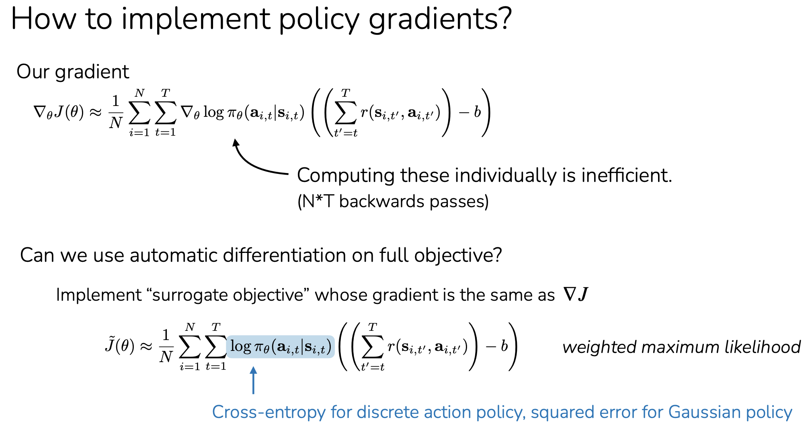

## Q: explain this trick clearly. what's the process before and after?

The trick is: **turn the policy-gradient formula into a fake supervised-learning loss**, so autograd can compute the gradient in one backward pass.

Original gradient:

$$
\nabla_\theta J(\theta)
\approx
\frac{1}{N}\sum_i\sum_t
\nabla_\theta \log \pi_\theta(a_{i,t}|s_{i,t})
\left(R_{i,t}-b\right)
$$

where

$$
R_{i,t}=\sum_{t'=t}^T r(s_{i,t'},a_{i,t'})
$$

is the reward-to-go.

### Before the trick

You might think you need to manually compute:

$$
\nabla_\theta \log \pi_\theta(a_{i,t}|s_{i,t})
$$

for every state-action pair, then multiply each one by its return advantage:

$$
R_{i,t}-b
$$

That would mean many separate backward passes, one per timestep. Inefficient.

### After the trick

Define a **surrogate objective**:

$$
\tilde J(\theta)
=
\frac{1}{N}\sum_i\sum_t
\log \pi_\theta(a_{i,t}|s_{i,t})
\left(R_{i,t}-b\right)
$$

Then call autograd on this whole scalar once.

Because $R_{i,t}-b$ is treated as a constant weight, autograd gives:

$$
\nabla_\theta \tilde J(\theta)
=
\frac{1}{N}\sum_i\sum_t
\nabla_\theta \log \pi_\theta(a_{i,t}|s_{i,t})
\left(R_{i,t}-b\right)
$$

which is exactly the policy-gradient estimator.

So the process is:

1. Run policy, collect trajectories.
2. Compute reward-to-go $R_{i,t}$.
3. Subtract baseline $b$, giving advantage-like weights.
4. Compute log probability of each sampled action.
5. Multiply each log prob by its weight.
6. Sum everything into one scalar.
7. Backprop once.

Usually code minimizes a loss, so we use negative sign:

$$
\text{loss}
=
-\sum_{i,t}
\log \pi_\theta(a_{i,t}|s_{i,t})
\left(R_{i,t}-b\right)
$$

Interpretation:

$$
R_{i,t}-b > 0
$$

Increase probability of that action.

$$
R_{i,t}-b < 0
$$

Decrease probability of that action.

That is why the slide calls it **weighted maximum likelihood**: it looks like supervised learning on the sampled actions, but good actions get positive weight and bad actions get negative weight.

## Q: i don't follow. let's start with the before. you have the initial state that you forward pass. that gives you a categorical prob dist over actions. choose the highest prob action, record it and backprop to get the gradient of that state action pair wrt to each theta. next run the state action in the environment and get the next state and reward. accumulate future rewards. then repeat the next state forward pass and backpass. finally do the calculation of weighted gradient. is this correct?
Mostly, but two important fixes:

1. **Do not choose the highest-probability action.**
   In vanilla policy gradient, you usually **sample** an action from the categorical distribution.

$$
a_t \sim \pi_\theta(a_t \mid s_t)
$$

This is needed because the gradient estimates how changing probabilities affects expected reward.

2. **You usually do not backprop immediately at each state.**
   Conceptually, the “before trick” would compute each term separately, but in practice you first collect the whole trajectory, compute returns, then do one combined update.

The “before” concept is:

At each timestep:

$$
s_t \rightarrow \pi_\theta(\cdot \mid s_t)
$$

Sample action:

$$
a_t \sim \pi_\theta(\cdot \mid s_t)
$$

Run environment:

$$
s_t, a_t \rightarrow r_t, s_{t+1}
$$

Store:

$$
(s_t, a_t, r_t, \log \pi_\theta(a_t \mid s_t))
$$

After the trajectory ends, compute future return for each timestep:

$$
R_t = r_t + r_{t+1} + \cdots + r_T
$$

Then the desired gradient is:

$$
\sum_t \nabla_\theta \log \pi_\theta(a_t \mid s_t)(R_t-b)
$$

Conceptually, that says:

“Take the gradient of the log-probability of the action I sampled, then weight it by how good the future outcome was.”

So your version is close, except:

**Wrong:** choose highest-prob action.

**Right:** sample from the policy.

**Inefficient conceptual version:** backprop separately for every state-action pair.

**Efficient version:** store all log-probs, compute all returns, form one scalar surrogate loss, then backprop once.

The surrogate trick is just a way to avoid doing this manually:

$$
\text{loss} = -\sum_t \log \pi_\theta(a_t \mid s_t)(R_t-b)
$$

Backprop on this loss automatically produces:

$$
-\sum_t \nabla_\theta \log \pi_\theta(a_t \mid s_t)(R_t-b)
$$

which is the policy-gradient update direction.

## Q: let's first clear "before" first. how can you calculate gradient. there is no formula. you need to get the grad from the backprop only, no?
Yes. You are right: **in implementation, you get the gradient from backprop/autograd**.

The formula

$$
\nabla_\theta \log \pi_\theta(a_t|s_t)
$$

does **not** mean you manually derive gradients for every parameter. It means:

“Build the computation graph for $\log \pi_\theta(a_t|s_t)$, then ask backprop for its gradient with respect to $\theta$.”

For one state-action pair, the “before” would be:

```python
probs = policy(s_t)                  # forward pass
dist = Categorical(probs)
a_t = dist.sample()
logprob = dist.log_prob(a_t)

logprob.backward()                   # gives grad_theta log pi(a_t | s_t)
```

After that, each parameter has:

```python
param.grad
```

which corresponds to:

$$
\nabla_\theta \log \pi_\theta(a_t|s_t)
$$

Then conceptually you would multiply that gradient by the return weight:

$$
R_t - b
$$

So yes:

$$
\text{gradient for timestep } t
=
\text{backprop gradient of logprob}
\times
(R_t-b)
$$

The inefficient “before” version would be:

1. Forward pass at $s_t$.
2. Sample $a_t$.
3. Compute $\log \pi_\theta(a_t|s_t)$.
4. Backprop to get $\nabla_\theta \log \pi_\theta(a_t|s_t)$.
5. Later multiply by $R_t-b$.
6. Repeat for every timestep.
7. Sum all those weighted gradients manually.

The trick avoids doing many separate `backward()` calls. Instead of backpropagating each `logprob` separately, we create one scalar:

$$
\sum_t \log \pi_\theta(a_t|s_t)(R_t-b)
$$

and call `backward()` once. Autograd automatically produces the same weighted sum of gradients.

## Q: explain the "after" trick. how is this scalar calculated? is it: take the logprob for the sampled action after each forward pass. then calculate logprob * advantage? but we don't know the advantage yet until we have forward passed all the time steps. does the scalar get calculated after all the forward passes? and that calc builds the computation graph for the scalar? then you take the back pass which gives you the grad of the scalar wrt to theta, which math wise works out to the average weighted grad across timesteps?

Yes, you have it basically right.

**After trick process:**

1. Run the policy through the episode.
2. At each timestep, store the log-prob of the sampled action:

$$
\log \pi_\theta(a_t|s_t)
$$

3. Also store the reward $r_t$.
4. After the episode finishes, compute return / advantage for each timestep:

$$
A_t = R_t - b
$$

5. Now build one scalar objective:

$$
\tilde J(\theta)=\sum_t \log \pi_\theta(a_t|s_t) A_t
$$

or, as a loss to minimize:

$$
L(\theta)=-\sum_t \log \pi_\theta(a_t|s_t) A_t
$$

6. Call backprop once:

```python
loss.backward()
```

That gives:

$$
\nabla_\theta L(\theta)
=
-\sum_t \nabla_\theta \log \pi_\theta(a_t|s_t) A_t
$$

So yes: **the scalar is calculated after all forward passes**, once you know the rewards and advantages.

Important detail: the stored `logprob`s still have computation-graph connections to the policy parameters. The advantages are treated as fixed numbers, usually detached from the graph.

So the scalar looks like:

```python
logprobs = []
rewards = []

for t in range(T):
    probs = policy(s)
    dist = Categorical(probs)
    a = dist.sample()
    logprobs.append(dist.log_prob(a))

    s, r = env.step(a)
    rewards.append(r)

# after episode
returns = compute_returns(rewards)
advantages = returns - baseline

loss = 0
for logprob, advantage in zip(logprobs, advantages):
    loss += -logprob * advantage

loss.backward()
optimizer.step()
```

Math-wise, because differentiation is linear:

$$
\nabla_\theta \left(\sum_t \log \pi_\theta(a_t|s_t) A_t\right)
=
\sum_t A_t \nabla_\theta \log \pi_\theta(a_t|s_t)
$$

That is exactly the average weighted gradient across timesteps, or across timesteps and trajectories if you collect multiple episodes.

So your description is correct:

**collect logprobs first, compute advantages later, form scalar loss, backprop once, get weighted average policy gradient.**

## Q: for memory efficiency, do you calculate grad after each episode?
Usually, **yes**: in vanilla policy gradient, you backprop **after collecting a full episode** or after collecting a batch of full episodes.

Reason: you need the future return

$$
R_t = r_t + r_{t+1} + \cdots
$$

before you can weight each log-prob.

So the standard flow is:

$$
\text{collect episode(s)} \rightarrow \text{compute returns/advantages} \rightarrow \text{build loss} \rightarrow \text{backprop once}
$$

For memory, though, there is a catch: if you store all `logprob`s with their computation graphs, memory grows with episode length.

Common options:

**Simple teaching implementation:** store logprobs for one episode or batch, then backprop. Fine for short episodes.

**More memory-efficient implementation:** store only states, actions, and rewards. After the episode ends, compute advantages, then **re-run the policy forward pass** on the stored states/actions to recreate logprobs, build the loss, and backprop. This avoids keeping the whole graph alive during environment rollout.

So:

$$
\text{during rollout: store } (s_t, a_t, r_t)
$$

then later:

$$
\text{recompute } \log \pi_\theta(a_t|s_t)
$$

and backprop once.

In practice, many RL algorithms collect a batch of timesteps, then do updates from that batch. They do not usually backprop at every environment step.

## Q: not following the optimization of rollout first then calculate loss. explain clearly. after collecting the trajectories, do i have to do the forward passes one more time to get the logprobs? that still doesn't prevent building a large computtion graph spanning across time steps and trajectories. break it down step by step.
Yes, in the memory-efficient version you **do the forward pass again after collecting trajectories**.

The key idea is: **during rollout, do not keep the computation graph**.

### Version A: simple but memory-heavy

During rollout:

```python
logprobs = []
rewards = []

for t in range(T):
    probs = policy(s)              # builds graph
    dist = Categorical(probs)
    a = dist.sample()
    logprobs.append(dist.log_prob(a))  # stores graph

    s, r = env.step(a)
    rewards.append(r)
```

Problem: every stored `logprob` keeps its computation graph alive.

So memory grows with:

$$
\text{timesteps} \times \text{trajectories}
$$

Then after rollout:

```python
advantages = compute_advantages(rewards)
loss = -sum(logprob * adv for logprob, adv in zip(logprobs, advantages))
loss.backward()
```

This works, but can use lots of memory.

---

### Version B: memory-efficient

During rollout, you use the policy only to choose actions, but you **turn off graph tracking**:

```python
states = []
actions = []
rewards = []

for t in range(T):
    with torch.no_grad():
        probs = policy(s)          # no graph
        dist = Categorical(probs)
        a = dist.sample()

    states.append(s)
    actions.append(a)

    s, r = env.step(a)
    rewards.append(r)
```

Now you only stored plain data:

$$
(s_t, a_t, r_t)
$$

No computation graph is stored.

After the rollout ends:

```python
advantages = compute_advantages(rewards)
```

Then you do a **fresh forward pass**:

```python
probs = policy(states)             # builds one new graph
dist = Categorical(probs)
logprobs = dist.log_prob(actions)
loss = -(logprobs * advantages).mean()
loss.backward()
optimizer.step()
```

This still builds a graph, yes. But it only builds the graph for **one training batch**, not for the whole environment interaction history.

Important distinction:

The graph does **not** span through the environment dynamics:

$$
s_t \rightarrow a_t \rightarrow s_{t+1}
$$

We are not backpropagating through the environment or through time like RNN training.

The graph is just:

$$
\theta \rightarrow \pi_\theta(a_t|s_t)
$$

for each stored state-action pair.

So even if you have many timesteps, it is like supervised learning on a batch:

```python
inputs  = states
labels  = actions
weights = advantages
```

The loss is:

$$
L = -\frac{1}{B}\sum_t \log \pi_\theta(a_t|s_t) A_t
$$

Backprop computes:

$$
\nabla_\theta L
=
-\frac{1}{B}\sum_t A_t \nabla_\theta \log \pi_\theta(a_t|s_t)
$$

### Why this saves memory

In Version A, you keep graphs alive while the environment rollout is happening.

In Version B, rollout stores only data. Then training builds a graph briefly, backprops, and frees it.

For very large batches, you can also split into minibatches:

```python
for states_mb, actions_mb, adv_mb in minibatches:
    probs = policy(states_mb)
    dist = Categorical(probs)
    logprobs = dist.log_prob(actions_mb)
    loss = -(logprobs * adv_mb).mean()

    optimizer.zero_grad()
    loss.backward()
    optimizer.step()
```

Then the graph only covers one minibatch at a time.

So the answer is:

**Yes, you forward pass again after collecting trajectories. That does build a graph, but only for the current training batch or minibatch, not for the entire rollout process.**

## Q: the rollout should be to loops one over timesteps and another over episodes, correct? but the backprop loop is just one loop over batches. yes?
Yes.

**Rollout / data collection: usually nested loops**

```python
trajectories = []

for episode in range(num_episodes):
    s = env.reset()
    episode_data = []

    for t in range(max_timesteps):
        with torch.no_grad():
            probs = policy(s)
            a = sample(probs)

        s_next, r, done = env.step(a)

        episode_data.append((s, a, r))

        s = s_next
        if done:
            break

    trajectories.append(episode_data)
```

So rollout is often:

$$
\text{episodes} \rightarrow \text{timesteps}
$$

Then compute returns/advantages from the collected rewards.

**Training / backprop: usually loop over minibatches**

Flatten the collected data:

```python
states, actions, advantages = flatten(trajectories)
```

Then train:

```python
for batch in minibatches(states, actions, advantages):
    probs = policy(batch.states)
    dist = Categorical(probs)
    logprobs = dist.log_prob(batch.actions)

    loss = -(logprobs * batch.advantages).mean()

    optimizer.zero_grad()
    loss.backward()
    optimizer.step()
```

So yes:

$$
\textbf{rollout loop: episodes and timesteps}
$$

$$
\textbf{backprop loop: minibatches}
$$

One nuance: for vanilla REINFORCE, you might do just **one gradient update** on the whole collected batch. With minibatching, you split it for memory or efficiency.

## Q: i am not following the nuance of building the graph over the rollout st->at->st+1. do you mean this ends up building the computational graph between states and actions? but doesn't the graph only build between theta as parameters and the activations, which happen in both before and after? also, can you not just start the grad inside the loop at the beginning of each step to acoid capturing the dependencies between steps? may be show this with a small example.
You're right. In standard policy gradient, the computation graph does NOT connect states across timesteps. My earlier explanation was misleading.

And yes, you can backprop separately at each timestep. The complication is that you don't know the advantage yet.

Let's use a two-step episode.

## 1. What graphs actually get built?

At timestep 1:

```python
probs1 = policy(s1)
a1 = sample(probs1)
logp1 = log_prob(probs1, a1)
```

At timestep 2:

```python
probs2 = policy(s2)
a2 = sample(probs2)
logp2 = log_prob(probs2, a2)
```

Two independent forward-pass graphs sharing the same model parameters.

There are two graphs, one for each forward pass. They share $\theta$, but neither graph depends on the other.

When you sum `logp1 + logp2`, autograd simply combines their gradients.

## 2. Why not backprop immediately after each step?

Suppose the episode produces:

| Step | Reward | Return |
| ---- | ------ | ------ |
| 1    | 2      | 12     |
| 2    | 10     | 10     |

At step 1, you know `logp1` and reward 2, but you don't know its return is 12 until step 2 finishes.

You need:

$$
\nabla_\theta J = 12\nabla_\theta \log p_1 + 10\nabla_\theta \log p_2
$$

(assuming zero baseline and no discounting).

You have two options.

## 3. Option A: store graphs, then backprop

```python
# During rollout
logp1 = policy_logprob(s1, a1)  # graph 1
logp2 = policy_logprob(s2, a2)  # graph 2

# After the episode
loss = -(12 * logp1 + 10 * logp2)
loss.backward()
```

Both graphs must remain in memory until backward.

## 4. Option B: backprop each step separately, after the episode

Yes, you can avoid holding all graphs simultaneously.

```python
# Rollout without graphs
with torch.no_grad():
    # Sample actions and store states, actions, and rewards.
    ...

# After rollout, returns are known.
optimizer.zero_grad()
for s, a, R in [(s1, a1, 12), (s2, a2, 10)]:
    logp = policy_logprob(s, a)  # Build a small graph.
    loss = -R * logp
    loss.backward()              # Accumulate gradients.
optimizer.step()                 # Update once.
```

This is precisely the optimization you're suggesting.

Each `backward()` adds its gradient to the existing `param.grad`. It doesn't overwrite it.

After both backward calls:

$$
\theta.\mathrm{grad} = -12\nabla_\theta\log p_1 - 10\nabla_\theta\log p_2
$$

You get the same gradient as Option A, assuming the parameters remain unchanged between backward calls.

## 5. So why use batches?

Because processing states one at a time wastes GPU parallelism.

In practice, the compromise is:

- Collect trajectories without graphs.
- Compute advantages.
- Recompute log-probs for a minibatch of states/actions.
- Backprop once for that minibatch.
- Accumulate gradients across minibatches, then update the parameters.

Bottom line: You're correct that there's no need for a graph connecting timesteps. The memory problem is retaining many independent forward-pass graphs simultaneously. Recomputing and backpropagating in minibatches avoids that while benefiting from GPU parallelism.

## Q: but if the mini-batch size is the same as the episode length, the graph size will be exactly the same as keeping all graphs in memory, yes? it's just that we can cut down the episode into batches and only keep the graphs for the mini-batch size, which we have control over the size. yes?
Yes, exactly. You've got it.

- Minibatch size = episode length: The computation graph will be roughly the same size as retaining all the episode's forward-pass graphs.
- Minibatch size < episode length: Only the graphs for that minibatch need to be held in memory.
- Smaller minibatches: Less peak memory usage, but potentially more overhead from additional forward/backward passes.

The key advantage is that you control the minibatch size independently of the episode length.

One important detail: To reproduce the same full-episode gradient, you accumulate gradients across minibatches and call `optimizer.step()` only after processing all of them.

So yes, the optimization is primarily about controlling peak memory usage, while still allowing GPU-efficient batch processing.

## Q: if you do one step at a time, memory is small but GPU parallelism is zero, yes?
Yes, essentially.

- Batch size = 1: Minimal activation memory, but very poor GPU utilization. The GPU still parallelizes operations within the neural network, so parallelism isn't literally zero.
- Larger batches: More memory usage, but better GPU utilization because multiple states are processed simultaneously.

The tradeoff is memory vs. GPU throughput.

That's why minibatching is useful: choose the largest batch that gives good GPU efficiency while fitting comfortably in memory.

## Q: but mathwise, do you agree both approaches will build essentially the same graph if B = episode lenght (assume single episode)
Yes, mathematically they're equivalent.

Assuming one episode of length $T$ and minibatch size $B=T$:

- Approach 1: Keep the computation graphs from all $T$ forward passes during rollout.
- Approach 2: Collect the trajectory without gradients, then run all $T$ states through the policy in a single batch.

Both produce essentially the same computation graph: $T$ independent policy evaluations sharing the same parameters, followed by a weighted sum of their log-probabilities.

The gradients are identical (assuming unchanged parameters and deterministic network behavior).

The main difference is when the graph is constructed, not its mathematical structure or approximate memory size.

## Q: why "when the graph is constructed" important?
In your example—one episode of length $T$, with batch size $B=T$—it doesn't matter much for peak memory usage. You're right.

The difference is:

- During rollout: If you build graphs as you go, you must retain them until the episode finishes. This consumes GPU memory throughout the rollout.
- After rollout: You store only states, actions, and rewards. You build the graph after the episode, backprop immediately, and release it.

If both approaches process the entire episode at once, peak graph memory is approximately the same.

The real benefits of constructing the graph afterward are:

1. Minibatching: You can control peak memory independently of episode length.
2. GPU efficiency: You can process states in parallel rather than performing individual policy evaluations during environment interaction.
3. Flexibility: You can reuse collected trajectories for multiple training passes without retaining old graphs.

Bottom line: If $B=T$ and you only train once, there's little memory advantage. The main benefit comes when $B<T$.

## Q: so if i have two steps in an episode, both approaches will produce identical graph? show that
Yes, mathematically identical, but the actual autograd graphs are slightly different. Let's draw both.

Assume a two-step episode with states $s_1,s_2$, sampled actions $a_1,a_2$, and advantages $A_1,A_2$.

### Approach 1: Build graphs during rollout

Two independent forward-pass graphs are retained. Both connect to the same parameters $\theta$.

### Approach 2: Rollout without graphs, then batch forward pass

### Both calculate exactly the same loss

$$
L(\theta)=-[A_1\log\pi_\theta(a_1|s_1)+A_2\log\pi_\theta(a_2|s_2)]
$$

And backprop yields the same gradient:

$$
\nabla_\theta L=-A_1\nabla_\theta\log p_1-A_2\nabla_\theta\log p_2
$$

The distinction: Approach 1 creates two separate forward graphs. Approach 2 creates one batched forward graph. The internal autograd operations may differ, but the mathematical dependencies and gradients are equivalent, assuming the same parameters and deterministic computations.

And importantly, neither has a differentiable connection from $s_1$ through the environment to $s_2$.

## Q: neither has a differentiable connection from \(s_1\) through the environment to \(s_2\). ---> exactly my point. so, approch 2 just creates a new dim in the tensor.
Exactly. Approach 2 simply introduces a batch dimension so the GPU can process multiple states in parallel.

Instead of:

```python
policy(s1)  # shape [num_actions]
policy(s2)  # shape [num_actions]
```

You do:

```python
policy(torch.stack([s1, s2]))  # shape [2, num_actions]
```

The same network parameters $\theta$ are applied independently to both states.

No new mathematical dependencies between timesteps are introduced. It's essentially vectorizing the two forward passes.

The benefits are GPU parallelism and the ability to control memory through minibatch size.